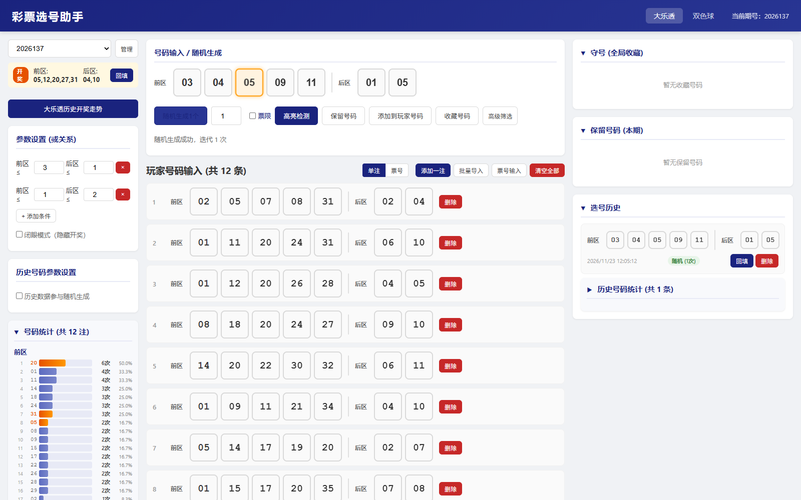
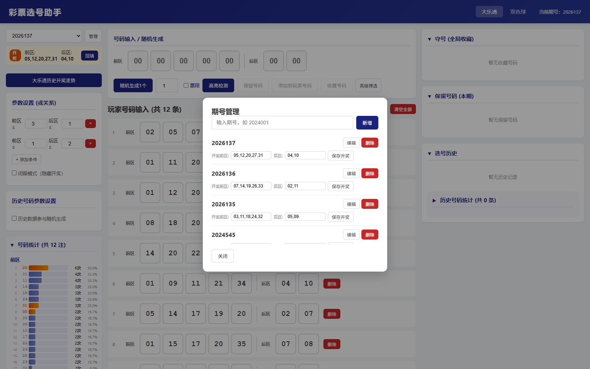

# 彩票选号助手工具

基于"反向排除"思路的选号辅助工具，支持**大乐透**和**双色球**两种玩法。

## 界面预览

**大乐透主界面**：最近三期开奖号码、随机生成的玩家号码、号码统计与选号历史



**期号管理**：最近三期已开奖号码的录入与维护



## 玩法规则

| | 大乐透 | 双色球 |
|------|--------|--------|
| 前区/红球 | 5个 / 35选5 | 6个 / 33选6 |
| 后区/蓝球 | 2个 / 12选2 | 1个 / 16选1 |
| 路由 | `/dlt` | `/ssq` |

## 功能概览

### 期号管理
- 创建、编辑、删除期号
- 录入开奖号码，回填到输入框
- 大乐透/双色球期号各自独立

### 玩家号码输入
- **单注添加**：5+2 方格输入（大乐透）或 6+1 方格（双色球），Tab 键跳转
- **批量导入**：逗号分隔格式，每行一注
- **复式输入**：选号池 → 自动展开 C(n,k) 组合
- **票号输入**：复式/多注两种模式，设置票号约束后自动展开为单注
- 列表展示按最新在前，高亮检测后按命中数排序
- 单注/票号两种视图切换

### 随机生成
- Fisher-Yates 洗牌法随机生成号码
- 三重过滤（顺序执行，全部通过才返回）：
  1. **筛选条件**：排除数字 + 必选数字，可启用/关闭
  2. **参数设置**：多组 `前区≤N + 后区≤M` 条件（或关系），与每注玩家号码比较
  3. **票号约束**：每张票号的多组限制条件（或关系）
- 生成结果自动填入方格并保存到历史

### 排除号码工具
位于高级筛选项，支持多种随机排除算法：

| 方法 | 逻辑 |
|------|------|
| 随1法 | 随机选一注 → 从中随机取一个前区号，取过的注不再取 |
| 全去重/权重法 | 按前区数字出现频率权重随机取一个 |
| 随全取1 | 每注各取一个前区号（不去重）→ 随机取一个 |
| 随全法 | 随机 N 注各取一个前区号 → 去重 → 全部赋值到排除 |
| 随全取1 | 随全法生成去重组 → 从中随机取一个 |

### 高亮检测
- 输入号码 → 检测与玩家号码的匹配
- 玩家号码列表、保留号码、选号历史、票号列表都有高亮
- 开奖号码录入后在统计面板和输入方格中高亮
- 票号视图显示命中结果 `2+1 (01,05 - 09)`

### 号码留存
- **保存到历史**：随机生成自动保存，手动可附加保存
- **保留号码**：按期号暂存，跨期号隔离
- **守号收藏**：全局收藏，不关联期号
- **添加到玩家号码**：一键将当前号码加入列表
- 所有留存均可回填到输入方格

### 号码统计
- **当期统计**（左侧栏）：玩家号码出现频率，降序排列，带序号和百分比柱状图
- **开奖高亮**：录入开奖号后统计中对应数字橙色标记
- **历史统计**（历史面板底部）：当期历史数据的时间范围过滤统计

### 历史开奖走势
- 左侧栏「历史开奖走势」按钮打开全屏走势图
- 数据来源：500.com（`datachart.500.com` 历史开奖数据页），由后端抓取并缓存到 `lottery_draw` 表，避免重复请求
- 可选最近 30/50/100/200/300 期，支持手动刷新
- 走势网格：行=期号（含开奖日期），列=前区/红球号码 + 后区/蓝球号码，命中以红/蓝球标记
- 底部汇总：每个号码的**出现次数**与**当前遗漏**（遗漏超阈值橙色提醒）
- 分区统计：前区低/中/高三个区间的出现次数与占比

## 技术栈

| 层级 | 技术 |
|------|------|
| 后端 | .NET 8 Web API |
| 前端 | Vue 2.7 + Vite 5 |
| 数据库 | SQLite（文件型，免安装） |
| ORM | SqlSugarCore (CodeFirst 自动建表) |
| API文档 | Swagger |
| 状态管理 | Vuex 3 |
| HTTP客户端 | Axios |

## 项目结构

```
ReverseNumbers/
├── backend/ReverseNumbers.Api/
│   ├── Controllers/         # API 控制器（DLT + SSQ 各一套）
│   ├── Services/            # 业务服务（DLT + SSQ 各一套）
│   ├── Models/Entities/     # 数据实体（15个表）
│   ├── Models/Dtos/         # 请求/响应 DTO
│   ├── Common/              # ApiResult, AppException
│   └── Extensions/          # SqlSugar 初始化
└── frontend/src/
    ├── api/                 # Axios API 封装
    ├── store/modules/       # Vuex 模块（DLT 7 + SSQ 7）
    ├── router/              # /dlt + /ssq 路由
    ├── components/
    │   ├── common/          # NumberSquare, NumberSquareGroup
    │   ├── issue/           # 期号选择、期号管理（含开奖录入）
    │   ├── player/          # 玩家号码、复式输入、票号面板、统计
    │   ├── generator/       # 号码输入/随机生成/高级筛选
    │   ├── history/         # 选号历史、保留号码、守号、历史统计
    │   └── layout/          # 头部导航、玩法规则
    └── views/               # MainView(DLT), SsqView(SSQ)
```

## 数据库表

### 大乐透 (DLT)

| 表名 | 用途 |
|------|------|
| `issue` | 期号 + 开奖号码 |
| `player_number` | 玩家号码 |
| `saved_number_history` | 选号历史 |
| `retained_number` | 保留号码 |
| `favorite_number` | 守号收藏 |
| `ticket` | 票号 |
| `system_config` | 系统配置 |

### 双色球 (SSQ)

| 表名 | 用途 |
|------|------|
| `ssq_issue` | 期号 + 开奖号码 |
| `ssq_player_number` | 玩家号码 |
| `ssq_saved_number_history` | 选号历史 |
| `ssq_retained_number` | 保留号码 |
| `ssq_favorite_number` | 守号收藏 |
| `ssq_ticket` | 票号 |
| `ssq_system_config` | 系统配置 |

启动时自动建表，无需手动 SQL。

## 快速开始

### 一键运行（推荐，Windows）

项目根目录的 `start.bat` 会自动完成 **环境检测 → 缺失运行时自动安装 → 依赖安装 → 启动服务**，适合首次下载后快速跑起来。

> 前提：首次运行需联网（用于自动下载缺失的运行时）。

**使用步骤**

1. 克隆或下载本项目
2. 双击根目录的 `start.bat`（或在终端执行 `start.bat`）
3. 脚本自动执行下述流程，全部就绪后自动打开浏览器

| 步骤 | 检测项 | 缺失时自动处理 |
|------|--------|----------------|
| 1 | Node.js（≥18） | 通过 `winget` 静默安装 LTS 版 |
| 2 | .NET SDK（≥8） | 通过 `winget` 安装 .NET 8 SDK，失败则回退官方 `dotnet-install.ps1` |
| 3 | 前端 `node_modules` | 自动执行 `npm install` |
| 4 | 端口 5247 / 5173 | 未运行则各自开窗口启动，已在运行则跳过 |

启动完成后的访问地址：

- 前端页面：http://127.0.0.1:5173/
- 后端接口：http://127.0.0.1:5247/
- 接口文档（Swagger）：http://127.0.0.1:5247/swagger

仅检测环境、不启动服务：

```bat
start.bat check
```

> **注意事项**
> - 自动安装依赖 `winget`（Windows 10/11 自带）；安装软件时可能弹出 UAC 授权框，点击“是”即可。
> - `start.bat` 为 **GBK 编码 + CRLF 换行**并设置了 `chcp 936`，如需编辑请保持该编码与换行格式，否则中文可能乱码。
> - 不使用脚本时，可按下方「手动启动」操作。

---

以下为不使用脚本时的**手动启动**说明。

### 前置条件（手动启动）

- .NET 8 SDK（≥8）
- Node.js 18+

> 上述运行时若缺失，也可直接使用上面的 `start.bat` 自动安装。

无需安装数据库。首次启动时自动创建 SQLite 数据库文件和所有表。

### 数据库

`backend/ReverseNumbers.Api/appsettings.json`：

```json
"ConnectionStrings": {
  "Default": "DataSource=arnumbers.db"
}
```

- 相对路径会解析到应用内容根目录（`dotnet run` 时为后端项目目录），首次启动自动创建 `arnumbers.db`
- 启动时自动执行 `CreateDatabase()` + CodeFirst `InitTables()`，并写入默认配置
- 数据库文件已加入 `.gitignore`（`*.db`）
- 若需要从旧的 MySQL 数据迁移，需自行导出转换；本项目不提供自动迁移

### 启动（手动）

```bash
# 后端
cd backend/ReverseNumbers.Api
dotnet run
# Swagger: http://127.0.0.1:5247/swagger

# 前端
cd frontend
npm install
npm run dev
# 页面: http://127.0.0.1:5173
```

## API 接口

所有接口返回 `{ code, message, data }`，code=0 成功。大乐透前缀 `/api/`，双色球前缀 `/api/ssq/`。

### 期号 `/api/issue`
| 方法 | 路径 | 说明 |
|------|------|------|
| GET | `/` | 列表(倒序) |
| POST | `/` | 新增 |
| PUT | `/{id}` | 修改 |
| PUT | `/{id}/result` | 保存开奖号码 |
| DELETE | `/{id}` | 级联删除 |

### 玩家号码 `/api/issue/{issueId}/player-numbers`
| 方法 | 路径 | 说明 |
|------|------|------|
| GET | `/` | 列表 |
| POST | `/` | 添加一注 |
| POST | `/batch` | 批量添加 |
| DELETE | `/{id}` | 删除 |
| DELETE | `/` | 清空 |

### 生成 `/api/generate`
| 方法 | 路径 | 说明 |
|------|------|------|
| POST | `/random` | 随机生成（含筛选、约束检查） |
| POST | `/highlight` | 高亮检测 |

### 历史、保留、收藏、票号、配置
- `/api/history` — 选号历史 CRUD + 时间统计
- `/api/RetainedNumber` — 保留号码 CRUD
- `/api/FavoriteNumber` — 守号收藏 CRUD
- `/api/Ticket` — 票号 CRUD + 约束更新 + 展开为单注
- `/api/config` — 系统配置

## 核心算法

### 随机生成流程

```
循环（直到成功）：
  1. 筛选：从号码池排除指定号 + 强制包含必选号
  2. Fisher-Yates 洗牌随机生成
  3. 参数设置检查：对每注玩家号码，至少满足一组(前区≤N, 后区≤M)条件
  4. 票号约束检查：对每张票号，至少满足一组约束条件
  5. 全部通过 → 返回结果 + 匹配详情
```

三步全部通过才返回，任一步不满足则重新生成。

### 高亮检测
输入号码与所有玩家号码逐注比对，判断前区/后区是否包含对应数字，命中即高亮。保留号码、历史、票号同理。

## 使用流程

1. 选择玩法（大乐透/双色球）
2. 创建/选择期号
3. 输入玩家号码（单注/批量/复式/票号）
4. 随机生成或手动输入号码 → 高亮检测
5. 查看统计、保存历史、管理保留/收藏号码
